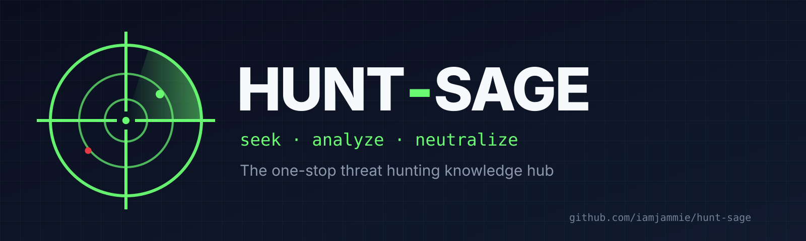

<!-- Banner -->
<p align="center">
  
</p>

<h1 align="center">Hunt-Sage</h1>
<p align="center"><strong>The one-stop threat hunting knowledge hub.</strong><br>
Theory, 25 hunt playbooks, 6 scenario hunt packs, a 122-hypothesis library, query patterns, cheat sheets (web + PDF), labs, interactive tools and 43 CI-validated Sigma rules, all mapped to MITRE ATT&amp;CK.</p>

<p align="center">
  <a href="https://iamjammie.github.io/hunt-sage/"></a>
  <a href="https://github.com/iamjammie/hunt-sage/actions/workflows/validate.yml"></a>
  <a href="https://github.com/iamjammie/hunt-sage/actions/workflows/pages.yml"></a>
  
  
  
  
  <a href="LICENSE.md"></a>
</p>

<p align="center">
  <a href="https://iamjammie.github.io/hunt-sage/"><strong>Visit the site</strong></a> ·
  <a href="https://iamjammie.github.io/hunt-sage/hunt/">Playbooks</a> ·
  <a href="https://iamjammie.github.io/hunt-sage/hunt/packs/">Hunt packs</a> ·
  <a href="https://iamjammie.github.io/hunt-sage/hunt/finder/">Playbook finder</a> ·
  <a href="https://iamjammie.github.io/hunt-sage/hunt/hypotheses/">Hypothesis library</a> ·
  <a href="https://iamjammie.github.io/hunt-sage/research/mitre-mapping/">ATT&amp;CK coverage</a> ·
  <a href="https://iamjammie.github.io/hunt-sage/cheatsheets/">Cheat sheets</a> ·
  <a href="https://github.com/iamjammie/hunt-sage/issues">Report an issue</a>
</p>

---

## What is Hunt-Sage?

A public knowledge base that takes you from **"what is threat hunting?"** to **running hunts, shipping detections and building a hunt program**, with the theory and the practical, copy-paste-ready material in one place. Everything is defensive, vendor-neutral where it can be, and written for people who have a SIEM open in the next tab.

```text
Learn the theory → pick a hypothesis → check your telemetry → run a playbook (or a whole pack) → practise in the lab → write the Sigma rule → track it on the coverage map
```

## What's inside

| Section | What you get | Start here |
|---|---|---|
| 📘 **Learn** | 9 chapters + glossary (90+ terms): hunting vs. detection vs. IR, the hunt loop, PEAK / TaHiTI / Sqrrl / HMM, hypotheses and intel, data & telemetry, hunting techniques, adversary tradecraft, detection engineering, building a program, **careers & 40 interview questions**; reading progress is tracked in the browser, and an interactive **hunt maturity self-assessment** (20 questions, 5 dimensions) produces a scorecard and reading list | [`learn/`](learn/index.md) |
| 🎯 **Hunt** | **25 playbooks**, each with a front-matter-driven header card, hypothesis, data checks, **KQL + SPL** queries, triage, false positives, escalation criteria, Atomic Red Team emulation, hardening, and an auto-generated footer listing the Sigma rules and hypotheses mapped to it: phishing & initial execution, PowerShell, LOLBins, DLL hijacking, process injection, **UAC bypass**, LSASS, Kerberoasting, DCSync, AD CS abuse, AD discovery & BloodHound, **network share & file discovery**, lateral movement, RDP/WinRM anomalies, persistence, defense evasion, C2/DNS, exfiltration, ransomware precursors, web shells, Linux, **macOS**, **Kubernetes & containers**, cloud & identity, **business email compromise** | [`hunt/`](hunt/index.md) |
| 🧭 **Hunt packs** | 6 scenario campaigns that chain the playbooks along a kill chain with a five-day plan, pivot map, live-detection checklist, tabletop prompts and hardening: ransomware kill chain, AD domain dominance, BEC & cloud identity takeover, web compromise → internal pivot, insider & departing-employee data theft, Linux server intrusion | [`hunt/packs/`](hunt/packs/index.md) |
| 🔦 **Playbook finder** | Tick the telemetry you collect; the finder sorts every playbook into ready / partially runnable / not yet, and names the single log source that would unlock the most hunts | [`hunt/finder.md`](hunt/finder.md) |
| 💡 **Hypothesis library** | 122 ready-to-run hunt hypotheses (H-001…) in "if X, then Y in Z" form, mapped to ATT&CK, data sources, analytical technique and playbook, with a live filter (`?q=H-057` deep links work) | [`hunt/hypotheses.md`](hunt/hypotheses.md) |
| 🔎 **Query index** | 29 reusable hunting patterns in KQL and SPL side by side: rarity stacking, baselining, first-seen, beacon timing, process↔network joins, cloud sign-in anomalies | [`hunt/query-index.md`](hunt/query-index.md) |
| 🧾 **Cheat sheets** | 8 references, each as a **filterable web page** and a watermarked A4 PDF: Windows & Sysmon event IDs, Linux logs/auditd, KQL, Splunk SPL, Zeek/network, LOLBins, AD attack artefacts | [`cheatsheets/`](cheatsheets/index.md) |
| 🧪 **Labs** | Build a hunting lab, Atomic Red Team emulate-then-detect exercises, public datasets and ranges | [`labs/`](labs/index.md) |
| 🧬 **Research** | **43 ATT&CK-mapped Sigma rules** validated in CI (Windows, Linux, macOS, Microsoft 365, Kubernetes), an **ATT&CK coverage heatmap generated from the content** (140 techniques, no planned gaps left), an importable **Navigator layer**, and detection-engineering notes | [`research/`](research/index.md) |
| 📋 **Templates** | Hunt hypothesis card, hunt report, backlog, data-source assessment, IR hand-off | [`templates/`](templates/index.md) |
| 📚 **Resources** | Tooling, rule repositories, reports, podcasts, newsletters, courses, books, communities | [`resources/`](resources/index.md) |
| 📝 **Blog** & 🚩 **CTF** | Field notes, a worked stacking/baselining example, an end-to-end case study, and three defender-focused CTF challenges | [`_posts/`](_posts), [`_ctf/`](_ctf) |

## Repository layout

```text
learn/              Theory chapters, careers guide, glossary
hunt/               Playbook library, playbook finder, hypothesis library, query index
  playbooks/        25 hunt playbooks (front matter drives the header cards, tables, finder and coverage map)
  packs/            6 scenario hunt packs that chain the playbooks
cheatsheets/        Generated cheat-sheet pages + built PDFs (sources in scripts/cheatsheets/)
labs/               Lab build, emulation exercises, datasets
templates/          Hunt templates
resources/          Curated tools, rule repos, reading, courses, communities
research/
  sigma/            Sigma rules (validated by CI)
  mitre-mapping/    Coverage map page + ATT&CK Navigator layer (generated)
_data/attack.yml    ATT&CK technique names/tactics used by the coverage builder
_data/datasources.yml  Telemetry sources (labels, groups, how-to links) used by playbooks and the finder
_data/coverage.yml  Generated coverage data incl. per-playbook rules/hypotheses (do not edit)
_includes/          Generated heatmap + rule tables, playbook/pack header & footer cards, theme masthead override
_posts/ _ctf/       Blog posts and CTF challenges
assets/             Theme CSS/JS, brand images (SVG sources in assets/images/src/)
scripts/            Validators and builders used by CI
```

## How the pieces fit

```text
 intel / incident ─► hypothesis (hunt/hypotheses) ─► finder: do we have the logs? ─► playbook / hunt pack ─► lab emulation (labs)
                                                                                            │
                                                                                            ▼
                     coverage map ◄── build_coverage.py ◄── Sigma rule (research/sigma) ◄── tuning
```

Playbooks declare the techniques and telemetry they use in front matter, Sigma rules carry ATT&CK tags, hypotheses link their playbook, packs list their playbooks. `scripts/build_coverage.py` turns all of it into the heatmap, the rule index, a Navigator layer and the per-playbook data behind the header cards, footers and the finder. If a page says a rule exists, the rule exists; CI fails otherwise.

## Quality checks

CI runs on every push and pull request:

```bash
pip install -r scripts/requirements.txt
python scripts/validate_rules.py        # Sigma syntax, metadata, ATT&CK tags, Splunk/KQL conversion, index listing
python scripts/check_links.py           # front matter, internal links and anchors, nav entries
python scripts/build_coverage.py --check # generated coverage data is up to date
python scripts/build_cheatsheet_pages.py --check # cheat-sheet pages match their sources
bundle exec jekyll build --strict_front_matter   # the site builds
```

### Rebuilding generated files

```bash
python scripts/build_coverage.py        # coverage map, rule index, Navigator layer, per-playbook data
python scripts/build_cheatsheet_pages.py # cheat-sheet web pages
python scripts/build_images.py          # banner, favicon, social card, post teasers (needs rsvg-convert)
python scripts/build_cheatsheets.py     # PDF cheat sheets (needs Node.js + Playwright Chromium)
```

### Local preview

```bash
bundle install
bundle exec jekyll serve --livereload   # http://localhost:4000/hunt-sage/
```

> Sigma rules are marked `experimental` until validated in a lab (`test`) and in production (`stable`). Queries in the playbooks are starting points: adapt field names to your data schema and test them before relying on them.

## Built with

- GitHub Pages via GitHub Actions (static, no backend, no cookies, no tracking)
- Jekyll + the **Minimal Mistakes** theme, with a Hunt-Sage skin, dark/light toggle, copy buttons on every query, auto-linked ATT&CK ids, live table filters, and the finder / self-assessment / progress tools in ~600 lines of dependency-free JavaScript (state stays in your browser; nothing is sent anywhere)
- Markdown, YAML (Sigma), a little CSS/JS, Python for the builders

## Roadmap

| Milestone | Status |
|---|:---:|
| Learn path, playbook library, cheat sheets, labs, templates | ✅ |
| Sigma rule pack with CI validation | ✅ 43 rules |
| Playbooks for RDP/WinRM anomalies, DLL hijacking, process injection, AD CS abuse | ✅ |
| Phishing/initial execution and AD discovery/BloodHound playbooks | ✅ |
| Hypothesis library, query index, generated ATT&CK coverage + Navigator layer | ✅ |
| UAC bypass, network share discovery, automated exfiltration, non-application-layer C2 (the last map gaps) | ✅ |
| BEC/mailbox abuse, Kubernetes & containers, macOS playbooks | ✅ |
| Hunt packs (6 scenario campaigns) | ✅ |
| Cheat sheets as filterable web pages; playbook finder; maturity self-assessment; learning-path progress | ✅ |
| Lab-validate rules and promote `experimental` → `test` | 🚧 |
| Splunk ESA / Fortinet FortiAnalyzer rule packs | 🔜 |
| Downloadable CTF challenge artefacts | 🔜 |
| GCP, Okta and Google Workspace identity playbooks | 🔜 |
| Community submission workflow & contributor hall of fame | 🕒 |

## Contributing

Contributions are welcome: playbooks, Sigma rules, hypotheses, corrections, new challenge ideas. See **[CONTRIBUTING.md](CONTRIBUTING.md)** for conventions and the local checks to run, and use the issue templates for proposals.

1. Fork the repo and create a branch
2. Make your change, run the scripts above, commit any regenerated files
3. Open a pull request with a clear explanation

## Contact

- 📧 hunt-sage@gov.in
- 🔗 https://www.linkedin.com/in/ashok-kumar-5b62819b
- 🐙 https://github.com/iamjammie

## Responsible use

Everything here is for **defensive** purposes in environments you own or are authorised to test. Run attack emulation only in isolated labs or with written approval.

## Licence

All original content is © 2025-2026 iamjammie. Educational and defensive use is permitted with attribution; see [LICENSE.md](LICENSE.md).

---

<p align="center"><strong>Crafting defenders for the digital battlefield.</strong><br>© Hunt-Sage</p>
